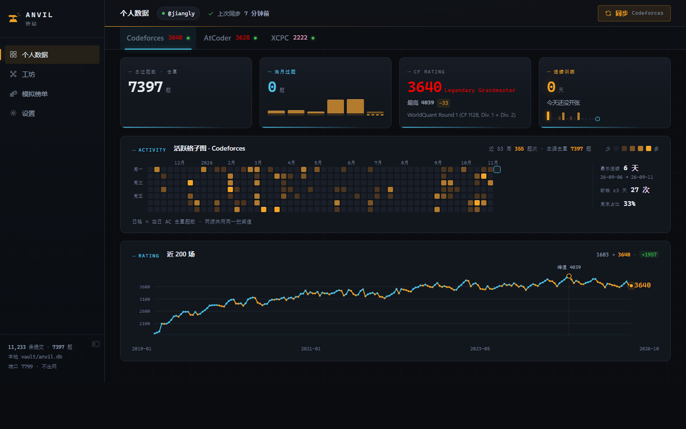
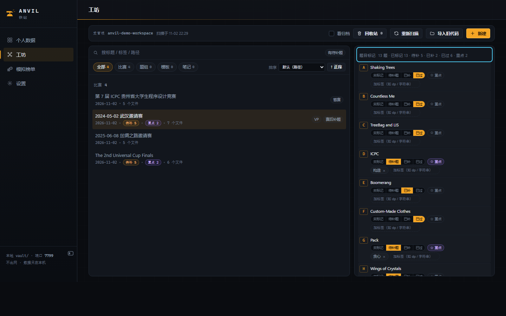
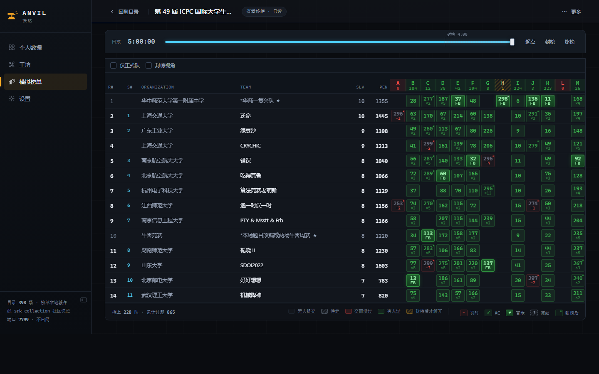

# ANVIL（铁砧）

个人 ICPC 训练工作台 · 本地 Web 应用：把 Codeforces / AtCoder 的训练数据、XCPC 选手档案、赛事回放榜和本地代码 / 题目标记收进一块本地仪表盘。数据只在本机，不出门。



## 功能

- **个人数据** —— CF / AT / XCPC 三源读数：活跃格子图、rating 曲线、提交统计、XCPC 档案长卷。
- **模拟榜单** —— 按官方快照重建赛事目录与逐秒回放榜：计时、封榜定格、终局解封、我的成绩。
- **工坊** —— 受管工作区：比赛 / 题组 / 模板 / 笔记；比赛可关联榜单、存 VP 成绩，并按题号记录「待补题 / 已补 / 已过 + 重点」。
- **设置** —— handle 校验与保存、单源同步、XCPC 认领。

## 快速开始

1. Node ≥ 24（需要内置 `node:sqlite`）。
2. `npm install`
3. 启动：
   - 开发：`npm run dev`（Vite 5173 + 服务 7788，前端热更新）
   - 正式：`npm run build` 后 `npm start`（只起 7788 服务构建产物），浏览器打开 http://localhost:7788
   - 首次运行会读 `vault.example/` 初始化 `vault/`。

`start.bat` / `stop.bat` 是 Windows 双击入口：start 会按需构建（前端源码有变化才构建），自动打开浏览器，服务窗口最小化运行；端口被占用时会让你三选一。

`vault/` 是本地数据目录（SQLite、配置、榜单缓存），**不入库**；换机器时把它一并拷走即可。

| 工坊 · 题目标记 | 模拟榜单 · 回放 |
|---|---|
|  |  |

## 数据来源与许可

- **Codeforces** —— 官方 API（codeforces.com/api）。
- **AtCoder** —— 官方参赛史（atcoder.jp）+ AtCoder Problems 社区数据（kenkoooo.com）。
- **XCPC** —— heimaom.cn 静态导出（xcpcrating 社区快照，非官方）。
- **赛事榜单快照** —— [algoux/srk-collection](https://github.com/algoux/srk-collection)（AGPL-3.0）：**仅在运行时拉取、不打包其代码或数据**，界面与页脚已署名。

免责：个人自用的本地工具，只监听 `127.0.0.1`；上游数据的准确性以生成方为准。README 截图使用公开榜单数据与演示工作区，仅作展示。

## 常见问题

### 双击 `start.bat` 弹「无法验证发布者」

这是 Windows 对可执行脚本的来源检查，不是脚本本身的问题：

1. 右键文件 → 属性。如果底部有「解除锁定」，勾选并确定（从 ZIP / 浏览器下载的常见情况）。
2. 如果没有「解除锁定」，检查完整性标签：`icacls start.bat`。若显示 `Low Mandatory Level`，在**管理员终端**执行（把 `<仓库根目录>` 换成实际路径）：

   ```bat
   icacls "<仓库根目录>" /setintegritylevel Medium
   icacls "<仓库根目录>\start.bat" /setintegritylevel Medium
   icacls "<仓库根目录>\stop.bat" /setintegritylevel Medium
   ```

   这是低完整性目录（沙箱 / 解压工具留下的标签）导致的，改成 Medium 即可，不是降低系统安全设置。

不想动管理员权限的话，也可以建一个快捷方式指向 `cmd.exe /c "<仓库根目录>\start.bat"`，由 cmd 启动批处理。

## 架构

模块划分、数据流与关键约束见 [ARCHITECTURE.md](ARCHITECTURE.md)。

## 公开快照说明

这个仓库是某个里程碑的公开快照，开发在私有仓库进行，更新按里程碑同步。`npm run verify` = typecheck + test + build；不含私有仓库的文档索引检查。

## License

[MIT](LICENSE)
